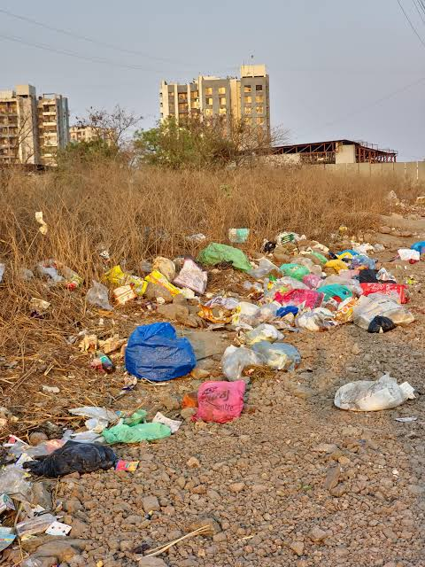
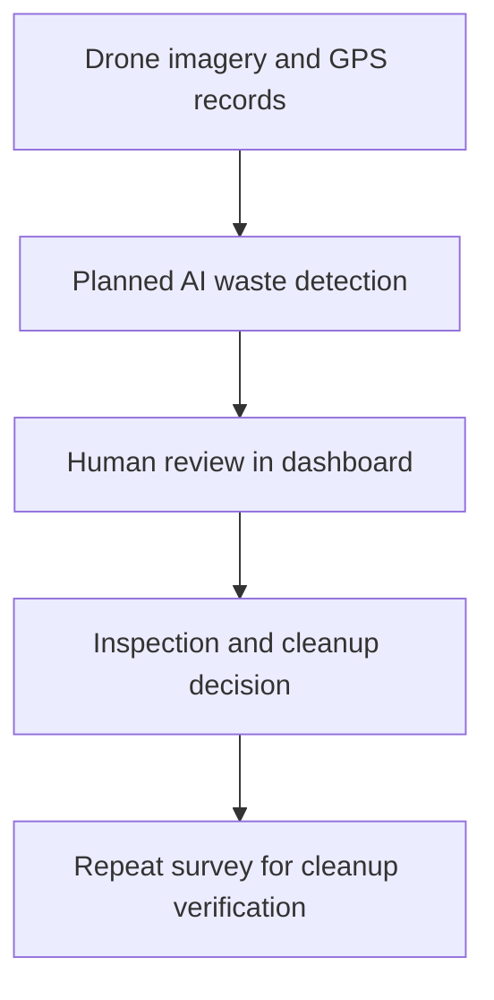

# InnoVision
### AI-assisted municipal waste inspection for Pune

InnoVision explores how drone imagery, GPS records and a map-based review interface can help sanitation teams locate visible waste hotspots and coordinate inspection. This repository contains the **interactive dashboard prototype**: a full-screen map, location-specific images and a human review workflow.

**[Open the GitHub Pages demo](https://sync-rohan-ization.github.io/AI-Muncipality-Helper/)**

> Development stage: hardware prototype built, dashboard demo functional. Drone-to-dashboard integration, AI inference and field validation are pending. The bounding boxes in this website are illustrative annotations.

## What the dashboard does

- Displays an interactive Pune map with GPS-positioned report markers.
- Opens report details only when a marker or menu option is selected.
- Shows a different reference image for each original sample location.
- Includes a user-supplied waste photograph and area coordinates for the ADYPU-area report.
- Lets users show or hide concept bounding boxes.
- Supports manual report creation, search, status filters and CSV export.
- Saves report records and status changes in the current browser using local storage.

## ADYPU-area observation

| Field | Value |
| --- | --- |
| Report | `IV-005` |
| Area | Charholi Budruk / Lohegaon, Pune |
| Supplied latitude | `18.62204` |
| Supplied longitude | `73.91091` |
| Photo | User-provided ground photograph |
| Review status on first load | Pending review |

The coordinates identify the user-supplied university area. The exact position of the waste pile has not been surveyed. The photo alone does not establish who deposited the waste or whether an offence occurred.

<details>
<summary>View the supplied waste photograph</summary>



</details>

## Intended municipal workflow



The current website demonstrates the map and review interface. Automatic image ingestion, model inference, crew notifications and repeat-survey comparison are future integration work.

## Hardware and software

| Component | Role | Current scope |
| --- | --- | --- |
| F450 drone platform | Proposed survey vehicle | Hardware prototype reported built |
| Raspberry Pi 4B and camera | Image capture and processing platform | Integration and testing pending |
| GPS | Location records | Dashboard accepts coordinates |
| HTML, CSS and JavaScript | User interface and interactions | Implemented |
| Leaflet 1.9.4 | Interactive map controls and markers | Loaded from unpkg |
| Esri light grey canvas | Map imagery and place labels | Internet connection required |
| Browser local storage | Local report persistence | Single-browser storage |
| AI detection model | Flag visible waste in imagery | Selection and validation pending |

## Run locally

There is no build step, package installation or API key required by this dashboard.

1. Download or clone this repository.
2. Keep `index.html` alongside the `assets` folder.
3. Open `index.html` in a modern browser.

For a local HTTP server, if Python is available:

```bash
python -m http.server 8000
```

Then visit `http://localhost:8000`. An internet connection is required for the map library and map tiles.

## Deploy to GitHub Pages

1. Extract the release ZIP on your computer. **Upload its contents, not the ZIP itself.**
2. Upload `index.html`, `README.md`, `.nojekyll` and the entire `assets` folder to the repository root. Replace matching files when prompted.
3. Open **Settings → Pages** in your GitHub repository.
4. Select **Deploy from a branch**, choose **main**, and choose **/ (root)**.
5. Save, then wait for the Pages build to complete under **Actions**.
6. Open the deployed website and click marker 5 to inspect the new report.

Expected structure:

```text
index.html
README.md
.nojekyll
assets/
  site-1.jpg
  site-2.jpg
  site-3.jpg
  site-4.jpg
  adypu-waste.png
```

**Missing photos?** Check that the `assets` folder exists at the repository root and that filenames match exactly. Uploading only `index.html` will leave image panels broken. After an update, refresh the page or use a hard refresh if your browser serves an older version.

## How to use

| Control | Behavior |
| --- | --- |
| Map marker | Opens the report and its image |
| Overview | Opens summary counts |
| Reports | Opens the searchable inspection register |
| + Report | Opens the manual location-entry form |
| Show / Hide boxes | Toggles illustrative annotations |
| Verify / Assign / Mark cleared / Reject | Changes the local report status |
| Export CSV | Downloads report records |
| Reset demo | Restores the initial records and removes local edits |

The ADYPU report is added automatically for returning visitors whose saved records predate this update. Other existing local records are preserved.

## Validation plan

The proposed first pilot covers **10 locations in one Pune locality over four weeks**. These are planning targets, not completed deployment results.

Testing will compare detections with manually reviewed observations and record false alerts, missed visible piles, location error, inspection time and total operating cost. Stakeholder feedback and operating permissions are prerequisites for a municipal field pilot.

## Current limitations

- No live drone connection or automatic GPS telemetry.
- No AI model runs in this version; boxes are drawn to explain the intended interaction.
- Status changes do not notify municipal crews or create external work orders.
- Browser-local data is not shared between devices, browsers or people, and can be lost when browser storage is cleared.
- The original four markers and their statuses are sample records. Stock photos do not depict those Pune coordinates.
- No municipal affiliation, approved partnership, measured cost savings or field-tested accuracy is claimed.

## Photo credits and attribution

| Asset | Photographer / source | Use |
| --- | --- | --- |
| [site-1.jpg](assets/site-1.jpg) | [Markus Spiske / Pexels](https://www.pexels.com/photo/a-pile-of-garbage-bags-4651148/) | Bagged street waste reference |
| [site-2.jpg](assets/site-2.jpg) | [Aiden Tieulie / Pexels](https://www.pexels.com/photo/urban-construction-zone-with-caution-tape-and-cone-32537514/) | Roadwork debris reference |
| [site-3.jpg](assets/site-3.jpg) | [Mike Bird / Pexels](https://www.pexels.com/photo/a-pile-of-trash-in-an-urban-area-6316243/) | Overflowing collection-point reference |
| [site-4.jpg](assets/site-4.jpg) | [Robert So / Pexels](https://www.pexels.com/photo/pile-of-trash-with-discarded-mattress-outdoors-29348622/) | Discarded bulky-waste reference |
| [adypu-waste.png](assets/adypu-waste.png) | User-provided photograph | User-supplied area observation |

Stock photos are subject to the [Pexels License](https://www.pexels.com/license/). The uploaded observation photo retains its original ownership. Concept boxes are website overlays; original photos are unchanged.

Map attribution is displayed in the interface. Leaflet is distributed under its BSD 2-Clause license. Esri map imagery and third-party content remain subject to their respective terms. This repository does not grant new rights to third-party assets.

## Team

- **Sankalp Rathore** — Hardware & Drone Systems
- **Rohan Lade** — AI & Software Systems

Developed as an Electronics & Telecommunication Engineering student innovation project for the Seva First Innovation Challenge, Maharashtra Zone.
